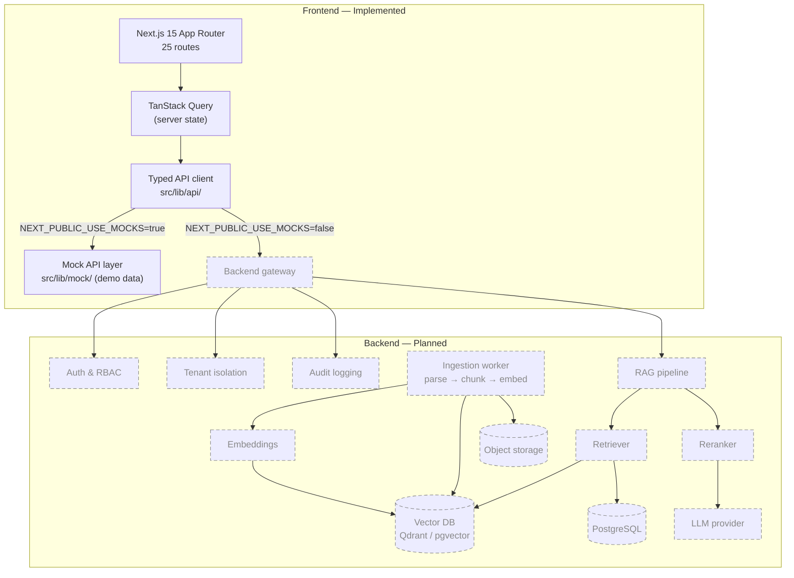

<div align="center">

# SecureRAG

**A secure, multi-tenant Retrieval-Augmented Generation (RAG) platform for enterprise knowledge retrieval.**

[](https://www.typescriptlang.org/)
[](https://nextjs.org/)
[](https://react.dev/)
[](https://tailwindcss.com/)
[](LICENSE)

</div>

---

## About SecureRAG

SecureRAG is an enterprise-oriented knowledge platform that lets teams upload private documents, organize them into collections, and ask natural-language questions with answers grounded in those documents — with citations back to the source.

The repository currently contains the **complete, production-styled frontend application**: 25 routes covering authentication, dashboard, chat with citations, document management, collections, directory, roles & permissions, audit logs, API keys, usage analytics, and settings. The UI runs today against a built-in **mock API layer**, and is structured to switch to a real backend by changing one environment variable.

> **Status:** the frontend is implemented and verified (lint, typecheck, and production build all pass). The backend services described below are in active planning — see the [Roadmap](#roadmap).

## Why SecureRAG?

Teams adopting LLMs for internal knowledge face a familiar set of problems:

- **Hallucinations** — general-purpose chat has no grounding in private data and no citations to verify against.
- **Data leakage** — consumer AI tools send proprietary documents to third parties with no tenancy boundaries.
- **No audit trail** — security and compliance teams cannot answer *who queried what, when, and which sources were used*.
- **Fragmented access control** — document permissions live in one system, AI access in another, and the two are never reconciled.

SecureRAG addresses these with a design built around **tenant isolation, document-level permissions, citation-backed answers, and end-to-end audit logging**.

## Core Features

Legend: ✅ implemented in this repository · 🚧 planned / in development

### 🔐 Security & Compliance

- ✅ **Authentication flows** — login, signup, and forgot-password screens with password strength metering
- ✅ **Role & permission management UI** — roles table, permission matrix, invite-user dialog
- ✅ **Audit log explorer** — filterable audit table with actor, action, target, and IP
- ✅ **API key management** — create, copy-once, rotate, and revoke keys with scoped permissions
- ✅ **Security overview dashboard** — MFA status, session policy, and security indicators
- 🚧 Server-side enforcement of authentication, authorization, and tenant isolation (FastAPI backend)

### 🧠 RAG Pipeline

- ✅ **Chat interface** — streaming-style responses, conversation history, suggested prompts
- ✅ **Inline citations** — every answer links to its source with a previewable snippet
- ✅ **Markdown rendering** of model output with code-block and table support
- 🚧 Document ingestion (parse → chunk → embed)
- 🚧 Vector retrieval with metadata filtering and tenant scoping
- 🚧 Reranking and grounded-answer synthesis with refusal on low-confidence results

### 📄 Knowledge Management

- ✅ **Documents** — upload (drag & drop), status lifecycle, metadata, filters, pagination, detail view
- ✅ **Collections** — create, organize, and browse grouped knowledge sets
- ✅ **Multi-format upload UI** — PDF, DOCX, Markdown, and text with per-file progress states
- 🚧 Background ingestion workers and object storage

### 📊 Enterprise Controls

- ✅ **Dashboard** — retrieval performance, query activity, recent activity, stat cards
- ✅ **Usage analytics** — token/model usage tables and charts
- ✅ **Settings** — general, AI provider, notifications, billing, security, and organization profiles
- ✅ **Organization switcher**, command palette (⌘K), dark mode, and notifications bell
- 🚧 SSO (SAML/OIDC), SLO-based quotas, and billing metering

## Architecture

Solid lines are implemented in this repository; dashed lines are planned backend services.



## Tech Stack

| Layer | Technology | Status |
| --- | --- | --- |
| Framework | Next.js 15 (App Router) | ✅ Implemented |
| UI library | React 19, TypeScript 5.9 | ✅ Implemented |
| Styling | Tailwind CSS 3.4, shadcn/ui, Radix UI | ✅ Implemented |
| Server state | TanStack Query v5 | ✅ Implemented |
| Client state | Zustand | ✅ Implemented |
| Forms & validation | React Hook Form + Zod | ✅ Implemented |
| Charts | Recharts | ✅ Implemented |
| Lint / types | ESLint (Next.js config), `tsc --noEmit` | ✅ Implemented |
| API layer | Typed client with mock/real switch | ✅ Implemented |
| Backend API | FastAPI (Python) | 🚧 Planned |
| Primary database | PostgreSQL | 🚧 Planned |
| Vector database | Qdrant (or pgvector) | 🚧 Planned |
| Ingestion & embeddings | Chunking service + embedding model | 🚧 Planned |
| LLM providers | OpenAI / Anthropic / self-hosted | 🚧 Planned |
| Object storage | S3-compatible | 🚧 Planned |
| Observability | OpenTelemetry + structured logs | 🚧 Planned |
| Deployment | Docker, GitHub Actions | 🚧 Planned |

## Project Structure

```text
SecureRag/
├── public/                      # Static assets
├── src/
│   ├── app/                     # App Router routes and layouts
│   │   ├── (auth)/              # login, signup, forgot-password
│   │   ├── app/                 # Authenticated application shell
│   │   │   ├── dashboard/       # Analytics overview
│   │   │   ├── chat/            # RAG chat with citations
│   │   │   ├── documents/       # Library, detail view [id]
│   │   │   ├── collections/     # Knowledge collections
│   │   │   ├── users/           # Directory & invitations
│   │   │   ├── roles/           # Roles & permission matrix
│   │   │   ├── audit-logs/      # Audit explorer
│   │   │   ├── api-keys/        # API key management
│   │   │   ├── usage/           # Token & model usage
│   │   │   ├── settings/        # general, ai, notifications, billing, security
│   │   │   └── forbidden/       # 403 state
│   │   ├── error.tsx            # Route error boundary
│   │   └── not-found.tsx        # 404 state
│   ├── components/
│   │   ├── ui/                  # shadcn/ui primitives
│   │   ├── layout/              # Sidebar, header, command palette, nav
│   │   └── …                    # auth, dashboard, chat, documents, security, usage
│   ├── lib/
│   │   ├── api/                 # Typed fetch client + API functions
│   │   ├── mock/                # Demo datasets + simulated latency
│   │   ├── queries.ts           # TanStack Query hooks
│   │   ├── types.ts             # Shared domain types
│   │   └── utils.ts             # cn() and helpers
│   ├── hooks/                   # use-client, use-mobile
│   └── stores/                  # Zustand UI store
├── .env.local.example           # Environment variable template
├── .gitignore
├── eslint.config.mjs
├── next.config.ts
├── package.json
├── tailwind.config.ts
└── tsconfig.json
```

## Getting Started

### Prerequisites

- **Node.js 18.18+** (developed on Node 25)
- npm 9+

### Installation

```bash
git clone https://github.com/enjoybaap6/SecureRag.git
cd SecureRag
npm install
```

### Configure environment

```bash
cp .env.local.example .env.local
```

### Run the development server

```bash
npm run dev
```

Open [http://localhost:3000](http://localhost:3000).

### Run quality checks

```bash
npm run lint        # ESLint
npm run typecheck   # tsc --noEmit
npm run build       # production build (25 routes)
```

## Environment Variables

| Variable | Default | Description |
| --- | --- | --- |
| `NEXT_PUBLIC_USE_MOCKS` | `true` | When `true`, the app runs entirely against the built-in mock API. Set to `false` once a real backend is available. |
| `NEXT_PUBLIC_API_URL` | `http://localhost:8000` | Base URL of the backend API used when mocks are disabled. |

> Only `.env.local.example` is committed. Real environment files (`.env`, `.env.local`, `.env*.local`) are git-ignored — never commit secrets.

## Development Workflow

```text
main     ──●              stable, reviewed releases only
            \
testing  ───●──●──●      day-to-day development
                 \
               (PR)       review → merge → main
```

1. Create a feature branch from **`testing`**
2. Run `npm run lint && npm run typecheck && npm run build` before pushing
3. Open a pull request from your branch into `testing`
4. Review and merge into `testing`; promote `testing` → `main` only after review

**Never push experimental changes directly to `main`.**

```bash
git checkout testing
git checkout -b feature/my-change
# …make changes…
npm run lint && npm run typecheck && npm run build
git push -u origin feature/my-change
# open a PR: feature/my-change → testing
```

## Security Considerations

SecureRAG is designed around these principles:

- **Tenant isolation** — every query is scoped to an organization; retrieval never crosses tenant boundaries (enforcement planned server-side).
- **Document-level permissions** — collection and document ACLs gate both UI access and retrieval.
- **Citations or refusal** — answers must cite retrieved sources; low-confidence retrieval should refuse rather than hallucinate.
- **Audit logging** — authentication, permission changes, document access, and queries are recorded with actor, action, target, and timestamp.
- **Secrets hygiene** — environment files are git-ignored; API keys are shown once at creation and stored hashed.
- **Prompt-injection defense** — retrieved content is treated as untrusted input, delimited, and never allowed to override system instructions (planned hardening phase).

> ⚠️ **This is a development project.** The current repository is frontend-only and runs against a mock API — access controls are not yet enforced by any server. Do not deploy it as-is to handle sensitive data.

## RAG Pipeline (Target Design)

```text
Documents ──► Parse ──► Chunk ──► Embed ──► Vector DB (per-tenant collection)
                                                   │
User question ──► Embed ──► Retrieve (ACL-filtered) ──► Rerank ──► Compose
                                                                    │
                                              Answer + citations ◄──┘
                                                  (or refusal if weak)
```

1. **Ingestion** — documents are parsed to text, chunked with overlap, embedded, and written to the vector store with metadata (`tenant_id`, `collection_id`, `permissions`, `page`).
2. **Retrieval** — the question is embedded and matched against vectors *within the caller's tenant and ACL scope*; metadata filters apply before similarity search.
3. **Reranking** — top candidates are re-scored for relevance.
4. **Composition** — the LLM answers strictly from retrieved context, citing chunk/page metadata; if retrieval confidence is too low, the system refuses.

The frontend already renders this flow (streamed chunks + inline citations); backend execution is on the roadmap.

## Multi-Tenancy

```text
Organization A                    Organization B
├── Users / Roles                 ├── Users / Roles
├── Collections ──► Documents     ├── Collections ──► Documents
└── Queries ──► Audit log         └── Queries ──► Audit log
        │                                  │
        └──── tenant_id filters on every read/write ────┘
```

- The UI includes an **organization switcher** and per-org settings, billing, and member management.
- Data returned by the mock API is pre-scoped per organization to mirror the intended backend behavior.
- **Planned:** every backend query carries a verified `tenant_id` derived from the authenticated session — never from client input.

## Roadmap

### Phase 1 — Frontend ✅

- [x] Next.js 15 App Router foundation, Tailwind + shadcn/ui design system
- [x] Authentication screens (login, signup, forgot-password)
- [x] App shell: sidebar, header, command palette, notifications, dark mode
- [x] Dashboard with charts and activity feeds
- [x] Chat with streaming UI, conversation history, and inline citations
- [x] Documents: upload, filters, detail view, permissions panel
- [x] Collections, directory, roles & permission matrix
- [x] Audit logs, API keys, usage analytics
- [x] Settings: general, AI, notifications, billing, security
- [x] Mock API layer with simulated latency and typed client
- [x] Quality gates: lint, typecheck, production build all passing
- [x] Repository setup: `main` + `testing` branches, polished README

### Phase 2 — Backend & RAG 🚧

- [ ] FastAPI service with tenant-aware auth (sessions / JWT)
- [ ] PostgreSQL schema: orgs, users, roles, documents, collections, audit
- [ ] Vector database integration (Qdrant or pgvector)
- [ ] Ingestion pipeline: parse → chunk → embed → index
- [ ] Retrieval + reranking + grounded answer composition with citations
- [ ] Wire frontend to real API via `NEXT_PUBLIC_USE_MOCKS=false`

### Phase 3 — Enterprise Hardening ⏳

- [ ] SSO (SAML / OIDC) and SCIM provisioning
- [ ] Prompt-injection hardening and content sanitization
- [ ] RAG evaluation harness (faithfulness, recall, citation accuracy)
- [ ] Observability: OpenTelemetry traces, metrics, structured logs
- [ ] Docker images and CI/CD (GitHub Actions)
- [ ] Independent security review before production use

## Contributing

1. Fork the repository and create your branch from `testing`
2. Make focused, well-scoped changes
3. Run `npm run lint && npm run typecheck && npm run build` — all must pass
4. Open a pull request into `testing` with a clear description of the change
5. After review, changes are merged into `testing`; releases are promoted to `main`

## License

This project is licensed under the [MIT License](LICENSE).

---

<div align="center">
<sub>Built for teams that need answers they can verify — and audits that prove them.</sub>
</div>
