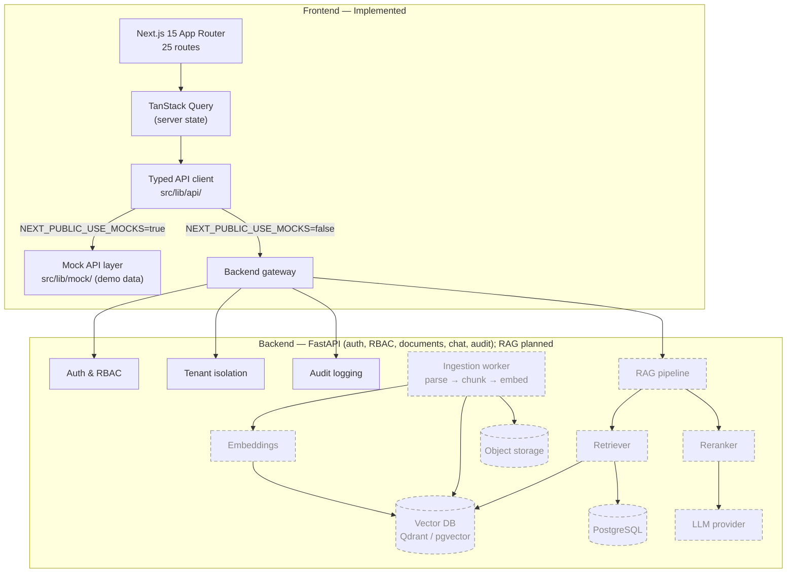

<div align="center">

# SecureRAG

**A secure, multi-tenant Retrieval-Augmented Generation (RAG) platform for enterprise knowledge retrieval.**

[](https://www.typescriptlang.org/)
[](https://nextjs.org/)
[](https://react.dev/)
[](https://tailwindcss.com/)
[](LICENSE)

</div>

---

## About SecureRAG

SecureRAG is an enterprise-oriented knowledge platform that lets teams upload private documents, organize them into collections, and ask natural-language questions with answers grounded in those documents — with citations back to the source.

The repository contains the **complete, production-styled frontend application** at the repo root: 25 routes covering authentication, dashboard, chat with citations, document management, collections, directory, roles & permissions, audit logs, API keys, usage analytics, and settings. The UI runs today against a built-in **mock API layer**, and is structured to switch to a real backend by changing one environment variable.

It also contains the **FastAPI backend** in [`backend/`](./backend): tenant-aware authentication (JWT + session cookies), user invitations, RBAC, documents, collections, chat, audit logging, API keys, usage analytics, settings, and search — all documented in an interactive API reference.

> **Status:** the frontend is implemented and verified (lint, typecheck, and production build all pass). The backend is implemented and verified (54 pytest tests passing, Ruff clean, server boots, `/api/v1/auth/accept-invite` registered) — see [Local Testing](#local-testing) and the [Roadmap](#roadmap).

## Why SecureRAG?

Teams adopting LLMs for internal knowledge face a familiar set of problems:

- **Hallucinations** — general-purpose chat has no grounding in private data and no citations to verify against.
- **Data leakage** — consumer AI tools send proprietary documents to third parties with no tenancy boundaries.
- **No audit trail** — security and compliance teams cannot answer *who queried what, when, and which sources were used*.
- **Fragmented access control** — document permissions live in one system, AI access in another, and the two are never reconciled.

SecureRAG addresses these with a design built around **tenant isolation, document-level permissions, citation-backed answers, and end-to-end audit logging**.

## Core Features

Legend: ✅ implemented in this repository · 🚧 planned / in development

### 🔐 Security & Compliance

- ✅ **Authentication flows** — login, signup, and forgot-password screens with password strength metering
- ✅ **Role & permission management UI** — roles table, permission matrix, invite-user dialog
- ✅ **Audit log explorer** — filterable audit table with actor, action, target, and IP
- ✅ **API key management** — create, copy-once, rotate, and revoke keys with scoped permissions
- ✅ **Security overview dashboard** — MFA status, session policy, and security indicators
- ✅ **Server-side enforcement of authentication, authorization, and tenant isolation** (FastAPI backend, [backend/app](./backend/app))

### 🧠 RAG Pipeline

- ✅ **Chat interface** — streaming-style responses, conversation history, suggested prompts
- ✅ **Inline citations** — every answer links to its source with a previewable snippet
- ✅ **Markdown rendering** of model output with code-block and table support
- 🚧 Document ingestion (parse → chunk → embed)
- 🚧 Vector retrieval with metadata filtering and tenant scoping
- 🚧 Reranking and grounded-answer synthesis with refusal on low-confidence results

### 📄 Knowledge Management

- ✅ **Documents** — upload (drag & drop), status lifecycle, metadata, filters, pagination, detail view
- ✅ **Collections** — create, organize, and browse grouped knowledge sets
- ✅ **Multi-format upload UI** — PDF, DOCX, Markdown, and text with per-file progress states
- 🚧 Background ingestion workers and object storage

### 📊 Enterprise Controls

- ✅ **Dashboard** — retrieval performance, query activity, recent activity, stat cards
- ✅ **Usage analytics** — token/model usage tables and charts
- ✅ **Settings** — general, AI provider, notifications, billing, security, and organization profiles
- ✅ **Organization switcher**, command palette (⌘K), dark mode, and notifications bell
- 🚧 SSO (SAML/OIDC), SLO-based quotas, and billing metering

## Architecture

Solid lines are implemented in this repository; dashed lines are planned backend services.



## Tech Stack

| Layer | Technology | Status |
| --- | --- | --- |
| Framework | Next.js 15 (App Router) | ✅ Implemented |
| UI library | React 19, TypeScript 5.9 | ✅ Implemented |
| Styling | Tailwind CSS 3.4, shadcn/ui, Radix UI | ✅ Implemented |
| Server state | TanStack Query v5 | ✅ Implemented |
| Client state | Zustand | ✅ Implemented |
| Forms & validation | React Hook Form + Zod | ✅ Implemented |
| Charts | Recharts | ✅ Implemented |
| Lint / types | ESLint (Next.js config), `tsc --noEmit` | ✅ Implemented |
| API layer | Typed client with mock/real switch | ✅ Implemented |
| Backend API | FastAPI (Python) — [`backend/`](./backend) | ✅ Implemented |
| Primary database | PostgreSQL (SQLite for local dev) — schema + Alembic migrations | ✅ Schema implemented |
| Vector database | Qdrant (or pgvector) | 🚧 Planned |
| Ingestion & embeddings | Chunking service + embedding model | 🚧 Planned |
| LLM providers | OpenAI / Anthropic / self-hosted | 🚧 Planned |
| Object storage | S3-compatible | 🚧 Planned |
| Observability | OpenTelemetry + structured logs | 🚧 Planned |
| Deployment | Docker, GitHub Actions | 🚧 Planned |

**Backend test suite:** `54 passed` (`pytest`) · `ruff check .` clean — see [Local Testing](#local-testing).

## Project Structure

```text
SecureRag/
├── backend/                     # FastAPI backend (Python)
│   ├── app/
│   │   ├── api/v1/              # Route modules: auth, users, documents, …
│   │   ├── core/                # Config, security, permissions, dependencies
│   │   ├── db/                  # Async engine + Alembic migrations
│   │   ├── models/              # SQLAlchemy models
│   │   ├── schemas/             # Pydantic request/response contracts
│   │   ├── services/            # Business logic (auth, invites, RAG stubs)
│   │   └── main.py              # App factory: /docs, /redoc, /health
│   ├── tests/                   # pytest suite (54 tests)
│   ├── alembic.ini
│   ├── requirements.txt         # Runtime dependencies
│   ├── requirements-dev.txt     # pytest + ruff
│   └── .env.example             # Backend environment template
├── public/                      # Static assets
├── src/
│   ├── app/                     # App Router routes and layouts
│   │   ├── (auth)/              # login, signup, forgot-password
│   │   ├── app/                 # Authenticated application shell
│   │   │   ├── dashboard/       # Analytics overview
│   │   │   ├── chat/            # RAG chat with citations
│   │   │   ├── documents/       # Library, detail view [id]
│   │   │   ├── collections/     # Knowledge collections
│   │   │   ├── users/           # Directory & invitations
│   │   │   ├── roles/           # Roles & permission matrix
│   │   │   ├── audit-logs/      # Audit explorer
│   │   │   ├── api-keys/        # API key management
│   │   │   ├── usage/           # Token & model usage
│   │   │   ├── settings/        # general, ai, notifications, billing, security
│   │   │   └── forbidden/       # 403 state
│   │   ├── error.tsx            # Route error boundary
│   │   └── not-found.tsx        # 404 state
│   ├── components/
│   │   ├── ui/                  # shadcn/ui primitives
│   │   ├── layout/              # Sidebar, header, command palette, nav
│   │   └── …                    # auth, dashboard, chat, documents, security, usage
│   ├── lib/
│   │   ├── api/                 # Typed fetch client + API functions
│   │   ├── mock/                # Demo datasets + simulated latency
│   │   ├── queries.ts           # TanStack Query hooks
│   │   ├── types.ts             # Shared domain types
│   │   └── utils.ts             # cn() and helpers
│   ├── hooks/                   # use-client, use-mobile
│   └── stores/                  # Zustand UI store
├── .env.local.example           # Environment variable template
├── .gitignore
├── eslint.config.mjs
├── next.config.ts
├── package.json
├── tailwind.config.ts
└── tsconfig.json
```

## Getting Started

### Prerequisites

Frontend:

- **Node.js 18.18+** (developed on Node 25)
- npm 9+

Backend:

- **Python 3.12+**
- pip

### Installation

```bash
git clone https://github.com/enjoybaap6/SecureRag.git
cd SecureRag
npm install
```

### Configure environment

Frontend — copy [`./.env.local.example`](./.env.local.example) to `.env.local`:

```bash
cp .env.local.example .env.local
```

Backend — copy [`./backend/.env.example`](./backend/.env.example) to `backend/.env`:

```bash
cd backend
cp .env.example .env    # Windows PowerShell: Copy-Item .env.example .env
```

For a local run **without a PostgreSQL server**, set this in `backend/.env` — it
uses a file-based SQLite database (`backend/securerag_dev.db`, created locally and
git-ignored) instead of the PostgreSQL default:

```bash
DATABASE_URL=sqlite+aiosqlite:///./securerag_dev.db
```

Leave `DATABASE_URL` at its PostgreSQL default if you have a local Postgres instance.

### Run the frontend (port 3000)

From the repository root (the directory containing `package.json`):

```bash
npm run dev
```

Open [http://localhost:3000](http://localhost:3000) *(local development link)*.

### Run the backend (port 8000)

```bash
cd backend
python -m venv .venv
# Windows:   .venv\Scripts\activate
# macOS/Linux: source .venv/bin/activate
pip install -r requirements-dev.txt
alembic upgrade head
python -m uvicorn app.main:app --reload --port 8000
```

### Start Qdrant (vector database)

Document ingestion (upload → chunks → embeddings → indexing) needs a Qdrant
instance. From the repository root:

```bash
docker compose up -d qdrant
```

Then set `QDRANT_URL=http://localhost:6333` in `backend/.env` (already the
default in `.env.example`). For a quick, dependency-free local run you can
instead set `QDRANT_URL=:memory:` (embedded, data lost on restart — tests use
this too). Uploads without any `QDRANT_URL` are marked `failed` rather than
silently "ready".

### Run quality checks

Frontend:

```bash
npm run lint        # ESLint
npm run typecheck   # tsc --noEmit
npm run build       # production build (25 routes)
```

Backend (run from `backend/`):

```bash
pytest              # 54 tests
ruff check .        # lint
```

## Local Testing

All `localhost` links on this page are **local-development links** — they only
resolve while the matching dev server is running on your machine. Repository files
and directories always use relative paths (for example [`./backend`](./backend)),
so they work on GitHub too.

### Backend — port 8000

Start it from [`backend/`](./backend):

```bash
python -m uvicorn app.main:app --reload --port 8000
```

Then open:

- Swagger UI — `http://localhost:8000/docs`
- ReDoc — `http://localhost:8000/redoc`
- OpenAPI JSON — `http://localhost:8000/openapi.json`
- Health — `http://localhost:8000/health`
- Readiness (checks the database) — `http://localhost:8000/health/ready`

[Swagger UI](http://localhost:8000/docs) ·
[ReDoc](http://localhost:8000/redoc) ·
[OpenAPI](http://localhost:8000/openapi.json) ·
[Health](http://localhost:8000/health)

> `/health` never touches the database (`{"status":"ok"}`). `/health/ready`
> returns `503` until `DATABASE_URL` points at a reachable database — see
> [Configure environment](#configure-environment) for the SQLite dev setup.

### Frontend — port 3000

Start it from the repository root:

```bash
npm run dev
```

Then open `http://localhost:3000` — [Frontend](http://localhost:3000).

The frontend runs against the built-in mock API by default. To exercise the real
backend, set this in `.env.local`:

```bash
NEXT_PUBLIC_USE_MOCKS=false
NEXT_PUBLIC_API_URL=http://localhost:8000
```

## API Reference

Interactive docs: [Swagger](http://localhost:8000/docs) ·
[ReDoc](http://localhost:8000/redoc) ·
[OpenAPI JSON](http://localhost:8000/openapi.json)
*(local-development links — start the backend first)*.

Canonical prefix: `/api/v1`. Every route is also mounted at the root without the
prefix as a compatibility alias for the Next.js client (hidden from the OpenAPI
schema).

Authentication: `Authorization: Bearer <accessToken>` **or** the HttpOnly session
cookies (`sr_access_token`, `sr_refresh_token`) set by register/login/accept-invite.
Tenant context is derived server-side from the session; an `X-Tenant-Id` header (or
`sr_tenant` cookie) hint is verified, never trusted blindly.

- **Health** — `GET /health`, `GET /health/ready`
- **Authentication** — `POST /api/v1/auth/register`, `POST /api/v1/auth/signup`,
  `POST /api/v1/auth/login`, `POST /api/v1/auth/refresh`, `POST /api/v1/auth/logout`,
  `GET /api/v1/auth/me`, `POST /api/v1/auth/forgot-password`,
  `POST /api/v1/auth/accept-invite`, `POST /api/v1/auth/oauth/{provider}` (501, not configured)
- **Tenants** — `GET /api/v1/tenants`, `GET /api/v1/tenants/current`, `PATCH /api/v1/tenants/current`
- **Users** — `GET /api/v1/users`, `GET /api/v1/users/{user_id}`,
  `POST /api/v1/users/invite`, `PATCH /api/v1/users/{user_id}`, `DELETE /api/v1/users/{user_id}`
- **Documents** — `GET /api/v1/documents`, `POST /api/v1/documents`,
  `GET /api/v1/documents/{document_id}`, `PATCH /api/v1/documents/{document_id}`,
  `DELETE /api/v1/documents/{document_id}`, `PUT /api/v1/documents/{document_id}/permissions`,
  `GET /api/v1/documents/{document_id}/pages`
- **Collections** — `GET /api/v1/collections`, `POST /api/v1/collections`,
  `GET /api/v1/collections/{collection_id}`, `PATCH /api/v1/collections/{collection_id}`,
  `DELETE /api/v1/collections/{collection_id}`
- **Chat** — `GET /api/v1/chat/conversations`, `POST /api/v1/chat/conversations`,
  `GET /api/v1/chat/conversations/{conversation_id}`,
  `DELETE /api/v1/chat/conversations/{conversation_id}`,
  `POST /api/v1/chat/conversations/{conversation_id}/messages`,
  `POST /api/v1/chat/messages/{message_id}/feedback`
- **Audit** — `GET /api/v1/audit` (OWNER/ADMIN)
- **API keys** — `GET /api/v1/api-keys`, `POST /api/v1/api-keys`, `DELETE /api/v1/api-keys/{key_id}`
- **Usage & analytics** — `GET /api/v1/usage`, `GET /api/v1/analytics/dashboard`,
  `GET /api/v1/analytics/usage`, `GET /api/v1/analytics/activity`
- **Settings** — `GET /api/v1/settings/general`, `PUT /api/v1/settings/general`
  (same pattern for `security`, `ai`, `notifications`, `billing`),
  `GET /api/v1/settings/billing/invoices`
- **Search** — `GET /api/v1/search`

Errors share one envelope:

```json
{
  "detail": "This invitation has already been accepted.",
  "error": { "code": "INVITE_ALREADY_ACCEPTED", "message": "This invitation has already been accepted." }
}
```

## Invitation Flow Testing

How a new member joins an organization (verified end-to-end; covered by
[`backend/tests/test_invitations.py`](./backend/tests/test_invitations.py)):

1. An authenticated **owner** or **admin** — the roles holding the `manage_users`
   permission — invites another user.
2. The backend creates the account as `status: "invited"` (inactive, unusable
   password) and generates an invitation token (valid 7 days).
3. Email delivery is not implemented yet, so **in development** the token is
   returned inline in the invite response as `inviteToken`.
4. The invited user submits the token plus a first password to
   `POST /api/v1/auth/accept-invite`.
5. The invitation activates the account (`status: "active"`) and sets the password.
6. The endpoint immediately returns a live session (`accessToken`, `refreshToken`,
   `tokenType`, `user`, `organizations`) and sets the session cookies.
7. The token is **single-use**: accepting twice returns `409 INVITE_ALREADY_ACCEPTED`;
   an invalid or expired token returns `400 INVITE_INVALID` / `400 INVITE_EXPIRED`.
8. In production (`APP_ENV=production`) responses never expose the raw invitation
   token — it must be delivered out-of-band (email) instead.

### Step 1 — invite (as owner/admin)

```bash
curl -X POST http://localhost:8000/api/v1/users/invite \
  -H "Authorization: Bearer <owner-access-token>" \
  -H "Content-Type: application/json" \
  -d '{"email":"newbie@example.com","role":"member","department":"Engineering","message":"Welcome!"}'
```

Request body: `email`, `role` (`owner` | `admin` | `manager` | `member` | `viewer`),
`department`, optional `message`.

Response `201` (development):

```json
{
  "id": "…",
  "name": "Newbie",
  "email": "newbie@example.com",
  "role": "member",
  "department": "Engineering",
  "status": "invited",
  "lastActive": "…",
  "createdAt": "…",
  "inviteToken": "eyJhbGciOi…"
}
```

### Step 2 — accept (no session required)

```bash
curl -X POST http://localhost:8000/api/v1/auth/accept-invite \
  -H "Content-Type: application/json" \
  -d '{"token":"<inviteToken from step 1>","password":"your-strong-password"}'
```

Request body is exactly `token` (20–4096 chars) and `password` (8–128 chars).
Response `200` is the same session shape as login — `accessToken`, `refreshToken`,
`tokenType`, `user`, `organizations` — with HttpOnly cookies set as well.

> Requests accept camelCase or snake_case; responses are always camelCase.

## Environment Variables

| Variable | Default | Description |
| --- | --- | --- |
| `NEXT_PUBLIC_USE_MOCKS` | `true` | When `true`, the app runs entirely against the built-in mock API. Set to `false` to use the real backend from [`./backend`](./backend). |
| `NEXT_PUBLIC_API_URL` | `http://localhost:8000` | Base URL of the backend API used when mocks are disabled (local-development URL). |

> Only `.env.local.example` and [`backend/.env.example`](./backend/.env.example) are committed. Real environment files (`.env`, `.env.local`, `.env*.local`) are git-ignored — never commit secrets.

## Development Workflow

```text
main     ──●              stable, reviewed releases only
            \
testing  ───●──●──●      day-to-day development
                 \
               (PR)       review → merge → main
```

1. Create a feature branch from **`testing`**
2. Run `npm run lint && npm run typecheck && npm run build` before pushing;
   for backend changes also run `cd backend && pytest && ruff check .`
3. Open a pull request from your branch into `testing`
4. Review and merge into `testing`; promote `testing` → `main` only after review

**Never push experimental changes directly to `main`.**

```bash
git checkout testing
git checkout -b feature/my-change
# …make changes…
npm run lint && npm run typecheck && npm run build
# backend changes: cd backend && pytest && ruff check .
git push -u origin feature/my-change
# open a PR: feature/my-change → testing
```

## Security Considerations

SecureRAG is designed around these principles:

- **Tenant isolation** — every query is scoped to an organization; API reads/writes never cross tenant boundaries (enforced server-side: tenant context is derived from the authenticated session, never from client input). Retrieval-time scoping ships with the RAG retrieval pipeline (not built yet).
- **Document-level permissions** — collection and document ACLs gate both UI access and retrieval.
- **Citations or refusal** — answers must cite retrieved sources; low-confidence retrieval should refuse rather than hallucinate.
- **Audit logging** — authentication, permission changes, document access, and queries are recorded with actor, action, target, and timestamp.
- **Secrets hygiene** — environment files are git-ignored; API keys are shown once at creation and stored hashed.
- **Prompt-injection defense** — retrieved content is treated as untrusted input, delimited, and never allowed to override system instructions (planned hardening phase).

> ⚠️ **This is a development project.** The frontend runs against a mock API by default, and the documented local backend setup uses a file-based SQLite dev database (`backend/securerag_dev.db`; PostgreSQL is the configured production target). Server-side auth, RBAC, and tenant isolation are implemented for the API routes, but the RAG pipeline (ingestion, retrieval, citations) is not built yet. Do not deploy it as-is to handle sensitive data.

## RAG Pipeline (Target Design)

```text
Documents ──► Parse ──► Chunk ──► Embed ──► Vector DB (per-tenant collection)
                                                   │
User question ──► Embed ──► Retrieve (ACL-filtered) ──► Rerank ──► Compose
                                                                    │
                                              Answer + citations ◄──┘
                                                  (or refusal if weak)
```

1. **Ingestion** — documents are parsed to text, chunked with overlap, embedded, and written to the vector store with metadata (`tenant_id`, `collection_id`, `permissions`, `page`).
2. **Retrieval** — the question is embedded and matched against vectors *within the caller's tenant and ACL scope*; metadata filters apply before similarity search.
3. **Reranking** — top candidates are re-scored for relevance.
4. **Composition** — the LLM answers strictly from retrieved context, citing chunk/page metadata; if retrieval confidence is too low, the system refuses.

The frontend already renders this flow (streamed chunks + inline citations); RAG execution (ingestion, retrieval, synthesis) remains on the [Roadmap](#roadmap).

## Multi-Tenancy

```text
Organization A                    Organization B
├── Users / Roles                 ├── Users / Roles
├── Collections ──► Documents     ├── Collections ──► Documents
└── Queries ──► Audit log         └── Queries ──► Audit log
        │                                  │
        └──── tenant_id filters on every read/write ────┘
```

- The UI includes an **organization switcher** and per-org settings, billing, and member management.
- Data returned by the mock API is pre-scoped per organization to mirror the intended backend behavior.
- **Backend:** every query carries a verified `tenant_id` derived from the authenticated session — never from client input (see [`backend/tests/test_tenant_isolation.py`](./backend/tests/test_tenant_isolation.py)).

## Roadmap

### Phase 1 — Frontend ✅

- [x] Next.js 15 App Router foundation, Tailwind + shadcn/ui design system
- [x] Authentication screens (login, signup, forgot-password)
- [x] App shell: sidebar, header, command palette, notifications, dark mode
- [x] Dashboard with charts and activity feeds
- [x] Chat with streaming UI, conversation history, and inline citations
- [x] Documents: upload, filters, detail view, permissions panel
- [x] Collections, directory, roles & permission matrix
- [x] Audit logs, API keys, usage analytics
- [x] Settings: general, AI, notifications, billing, security
- [x] Mock API layer with simulated latency and typed client
- [x] Quality gates: lint, typecheck, production build all passing
- [x] Repository setup: `main` + `testing` branches, polished README

### Phase 2 — Backend & RAG 🚧

- [x] FastAPI service with tenant-aware auth (JWT + HttpOnly session cookies)
- [x] Database schema + Alembic migration: orgs, users, roles, documents, collections, audit (PostgreSQL target; SQLite for local dev)
- [x] Invitation flow: `POST /api/v1/users/invite` → `POST /api/v1/auth/accept-invite` (single-use token)
- [x] RBAC, tenant isolation, audit logging, API keys, usage/settings endpoints
- [x] Quality gates: `pytest` 54 passed, `ruff check .` clean, server boots on port 8000
- [ ] Vector database integration (Qdrant or pgvector)
- [ ] Ingestion pipeline: parse → chunk → embed → index
- [ ] Retrieval + reranking + grounded answer composition with citations
- [ ] Wire frontend to real API via `NEXT_PUBLIC_USE_MOCKS=false`

### Phase 3 — Enterprise Hardening ⏳

- [ ] SSO (SAML / OIDC) and SCIM provisioning
- [ ] Prompt-injection hardening and content sanitization
- [ ] RAG evaluation harness (faithfulness, recall, citation accuracy)
- [ ] Observability: OpenTelemetry traces, metrics, structured logs
- [ ] Docker images and CI/CD (GitHub Actions)
- [ ] Independent security review before production use

## Contributing

1. Fork the repository and create your branch from `testing`
2. Make focused, well-scoped changes
3. Run `npm run lint && npm run typecheck && npm run build` — all must pass
   (backend changes: `cd backend && pytest && ruff check .`)
4. Open a pull request into `testing` with a clear description of the change
5. After review, changes are merged into `testing`; releases are promoted to `main`

## License

This project is licensed under the [MIT License](LICENSE).

---

<div align="center">
<sub>Built for teams that need answers they can verify — and audits that prove them.</sub>
</div>
